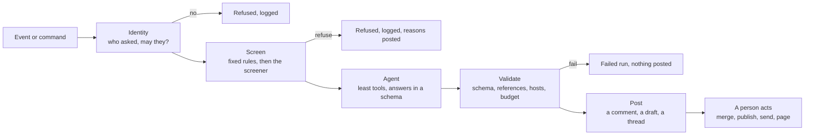

# Company agents: a baseline for running a company on agentic workflows

A set of agents that take the everyday traffic of an engineering organisation and do the legwork: describe a merge
request when it is opened, fill in a ticket when someone files one from the command line, write the documentation
when the ticket ships, answer in Slack or Teams, triage an alert, write the weekly digest. Anyone in the company runs
them from one CLI; CI runs them on events. A person stays in charge of every action that cannot be undone.

This folder is a baseline to copy into a new company, not a product. It reuses the shape of the QA pipeline in this
repository (see [workflows/README.md](../../workflows/README.md)) and the same rules: every agent gets the least
access its job needs and answers in a schema; everything it claims that code can check is checked before it is used;
a safety screen runs before any agent reads a request; and nothing is merged, deployed, deleted or sent to a customer
without a person.

## What is in the folder

| Path | What |
|---|---|
| [agents/](agents/) | One prompt per role, in the same shape as [agents/prompts/](../../agents/prompts/) in the engine. Each says what the role sees, what it may do, how it answers. |
| [schemas/schemas.ts](schemas/schemas.ts) | The shape every role answers in (zod). A run that does not validate is a failed run, never a posted comment. |
| [cli/](cli/) | `co`, the command anyone in the company uses: `co ticket new`, `co mr describe`, `co ask`, `co doc`, `co cases`, `co design`, `co alert`, `co post`, `co doctor`. Adapters for GitHub, GitLab, Jira, Confluence, TestRail, Slack and Teams. |
| [cli/lib/mcp.ts](cli/lib/mcp.ts) | The MCP servers an agent may read through, each in read-only mode with its tools allowlisted by name: GitHub, Atlassian (Jira and Confluence), TestRail, Figma. See [MCP servers](#mcp-servers-what-the-agents-may-look-up-themselves). |
| [docker/](docker/) | The onboarding container for Mac and Windows: one image with Node, the Claude Code CLI, `co` and the MCP servers, a guided first run, and `.env.example` with every token name and no values. |
| [workflows/github/](workflows/github/) and [workflows/gitlab/](workflows/gitlab/) | The same agents on events: a merge request opened, a ticket created, a ticket merged, an alert fired, a message in chat, a Monday morning. |
| [evals/](evals/) | Cases the agents must get right before a prompt change ships, including adversarial ones. |
| [GUARDRAILS.md](GUARDRAILS.md) | The trust model: who may trigger what, what each role may touch, how a bad actor is stopped, what is logged, where the kill switch is. |
| [ADOPTION.md](ADOPTION.md) | How to bring this into a company in the first ninety days, and the order to do it in. |

## The agents

| Role | Trigger | Reads | Writes | Who signs off |
|---|---|---|---|---|
| [request-screener](agents/request-screener.md) | Every request, before any other role | The request text | A verdict | Nobody: a refusal stops the run and is logged |
| [merge-request-describer](agents/merge-request-describer.md) | A merge request opened or pushed to; `co mr describe` | The diff, the linked ticket, the files around the diff, the test results | A description and a risk note on the merge request | The author edits; reviewers read |
| [merge-request-reviewer](agents/merge-request-reviewer.md) | After the describer, or on request | The diff, the repository | Review comments, never an approval | A human reviewer approves |
| [ticket-writer](agents/ticket-writer.md) | `co ticket new`; a chat message that starts with `/ticket` | The wish, the open tickets, the product brief | A draft ticket, filed only on confirmation | The person who asked |
| [ticket-enricher](agents/ticket-enricher.md) | A ticket created or moved to ready | The ticket, the code it touches, related tickets, the docs | A comment on the ticket: context, affected code, risks, questions | The product owner answers the questions |
| [test-case-writer](agents/test-case-writer.md) | `co cases`; a ticket with criteria | The ticket, the cases already in TestRail, the code, the design | Manual test cases, added to one TestRail section on confirmation | The person who asked |
| [design-reviewer](agents/design-reviewer.md) | `co design`; a UI merge request whose ticket links Figma | The diff, the Figma frame and its variants | A comment listing where code and design disagree | The author and the designer |
| [release-documenter](agents/release-documenter.md) | A merge request merged with a ticket key; `co doc` | The merged diff, the ticket, the existing documentation page | A documentation page, as a draft in Confluence or a docs pull request | A docs owner publishes |
| [doc-drift-checker](agents/doc-drift-checker.md) | Weekly; a merge to a folder the docs describe | The docs, the code they describe | A list of pages that no longer match the code, as tickets | The docs owner |
| [chat-responder](agents/chat-responder.md) | A mention of the bot in Slack or Teams; `co post` | The thread, the docs, the tickets and merge requests it names | A reply, drafted in a thread and sent on a reaction, or sent at once for read-only answers | The person who asked, for anything that is not an answer to a question |
| [alert-triager](agents/alert-triager.md) | An alert from monitoring; `co alert` | The alert, the runbook, recent deploys and merges, the logs it is allowed | A triage note: likely cause, blast radius, the runbook step to try, who to page | The on-call engineer acts |
| [incident-scribe](agents/incident-scribe.md) | An incident channel opened; `co incident` | The incident channel | A running timeline, and the post-mortem draft when it closes | The incident commander |
| [weekly-digest](agents/weekly-digest.md) | Monday 08:00 | Merged requests, closed tickets, open alerts, the week's incidents | A digest posted to a channel and a page | Nobody: it is read-only and labelled as the bot's |
| [onboarding-guide](agents/onboarding-guide.md) | `co ask`; a question in the help channel | The docs, the code, the tickets | An answer with the places it came from | Nobody: it is read-only and cites its sources |

Two roles already exist in the engine and are reused as they are: the skeptic and the requirements analyst
([agents/prompts/](../../agents/prompts/)), which `co ticket new` runs after the ticket writer.

## The shape every run has



Every stage is a separate process with its own credential. The job that runs the agent holds the model key and
nothing else. The job that posts holds the tracker or chat token and never runs a model. What passes between them is
a JSON file that validates against the schema in [schemas/schemas.ts](schemas/schemas.ts).

The agent never holds the token that could do damage, so a prompt injection in a ticket cannot make it do damage: the
worst it can do is produce a bad JSON file, and the validator and the person after it are there for that.

## Running it

**From a terminal, as anyone in the company:**

```bash
co ticket new "Shoppers should be able to save a wishlist"
```

The CLI screens the wish, asks the questions a developer would otherwise guess at, shows the ticket it would file,
and files it when you say yes. The enricher then runs on the new ticket in CI and posts its comment.

```bash
co mr describe 1234
co ask "how do we run the regression suite against staging?"
co doc SHOP-123 --preview
co alert ALRT-9981
co post "#shop-team" "the wishlist release is delayed to Thursday"
```

Every command that writes somewhere shows what it is about to write and asks. `--yes` skips the question and is
refused outside CI unless the role allows it. See [cli/README.md](cli/README.md).

**From CI, on events:** copy [workflows/github/](workflows/github/) or [workflows/gitlab/](workflows/gitlab/) into
the project. Each workflow is three jobs: fetch (tracker token, no model), agent (model key, no tracker token),
post (tracker token, no model). The JSON file between them is the only thing that crosses.

## MCP servers: what the agents may look up themselves

Four official or well-known MCP servers are wired in ([cli/lib/mcp.ts](cli/lib/mcp.ts)), so a role can look things up
on its own instead of only reading what the fetch stage put in its task: the enricher searches Jira for the history,
the reviewer opens the linked issue, the test case writer reads what TestRail already has, the design reviewer reads
the Figma frame.

| Server | From | How it runs | Read tools allowed |
|---|---|---|---|
| GitHub | [github/github-mcp-server](https://github.com/github/github-mcp-server) | Docker image, release binary (in the onboarding container) or the hosted endpoint; always with `GITHUB_READ_ONLY=1` and the `repos, issues, pull_requests, users` toolsets | issue and pull request read, search, file contents, commits |
| Atlassian | [atlassian/atlassian-mcp-server](https://github.com/atlassian/atlassian-mcp-server) (the official hosted server) | `https://mcp.atlassian.com/v2/mcp`, API-token auth (an Atlassian admin enables it) or OAuth for a person | `getJiraIssue`, `searchJiraIssuesUsingJql`, `getConfluenceContent`, `searchConfluence` and the other `read_*`/`search_*` tools |
| TestRail | [bun913/mcp-testrail](https://github.com/bun913/mcp-testrail) (`@bun913/mcp-testrail` on npm) | `npx`, with `TESTRAIL_URL`, `TESTRAIL_USERNAME`, `TESTRAIL_API_KEY` | every `get*` tool; none of `addCase`, `updateCase`, `addRun`, `addResult*` |
| Figma | [figma/mcp-server-guide](https://github.com/figma/mcp-server-guide) | The Figma desktop app's local Dev Mode server, or `https://mcp.figma.com/mcp` with an OAuth bearer token | `get_design_context`, `get_metadata`, `get_screenshot`, `get_variable_defs` |

The rules are the same for all four: the server runs in its read-only mode where it has one, every tool is
allowlisted by name so a write tool is refused even where the server exposes it, and the token it gets is a read token
that the post stage never uses. Writing still happens in code ([cli/adapters/](cli/adapters/)), after validation and
confirmation. Which roles get which servers is in `roles.<role>.mcp` in `co.config.json`; the tests in
[test/mcp.test.ts](test/mcp.test.ts) fail if a write-shaped tool name ever lands on an allowlist.

Two honest notes. The TestRail server's repository was archived in July 2026: it still runs, and the REST adapter in
[cli/adapters/testrail.ts](cli/adapters/testrail.ts) is the durable path for writes. Figma's hosted server wants OAuth,
which a person at a terminal gets through Claude Code's `/mcp` sign-in; in CI use a service user's token or skip the
design reviewer.

## Onboarding: the container

[docker/](docker/) is one image for Mac (Intel and Apple silicon) and Windows: Node, the Claude Code CLI, `co`, the
GitHub MCP binary and the TestRail server warmed in the cache. A new person installs Docker Desktop, copies
`.env.example` to `.env`, runs `onboard`, and answers the questions. No secret is in the image; tokens come from `.env`
or `co login`, and logins live in Docker volumes. `co doctor` says what is missing. Until the company has official
values, every field stays empty and people use their own tokens.

## Adding an agent

1. Write the prompt in `agents/<role>.md`: what it sees, what it may do, how it answers, what it must not do. Keep
   it under a page. State the output shape by name.
2. Add the output schema to `schemas/schemas.ts`. Every claim that code can check (a file path, a ticket key, a
   test name, a URL) is a field of its own, so the validator can check it.
3. Decide the access level from the table in [GUARDRAILS.md](GUARDRAILS.md#what-each-role-may-touch): read,
   comment, draft. There is no fourth level.
4. Add at least three cases to `evals/`: one plain, one vague, one adversarial.
5. Add the trigger: a command in `cli/co.ts`, a workflow, or both.
6. Run it on the bot's own test repository for a week before it sees real traffic.

## What this is not

It is not a way to remove people from decisions. Every arrow into the real world (merge, publish, send, page, pay)
ends at a person. It is a way to make sure that by the time a person looks, the description is written, the context
is gathered, the questions are asked and the draft is ready, so the person spends their time on the decision.
