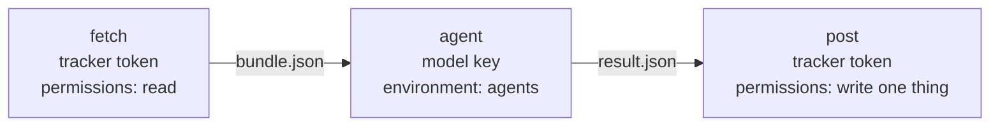

# Workflows: the agents on events

| Workflow | Event | Role | Output |
|---|---|---|---|
| [github/mr-describe.yml](github/mr-describe.yml) | Pull request opened, pushed to, marked ready | merge-request-describer | A comment, or the description with `--apply` |
| [github/mr-review.yml](github/mr-review.yml) | Marked ready; a collaborator comments `/review` | merge-request-reviewer | Review comments on diff lines, never an approval |
| [github/ticket-enrich.yml](github/ticket-enrich.yml) | Issue opened or labelled `ready`; Jira webhook | ticket-enricher | A comment on the ticket |
| [github/release-document.yml](github/release-document.yml) | Pull request merged | release-documenter | A Confluence draft page, or a docs pull request |
| [github/alert-triage.yml](github/alert-triage.yml) | Monitoring webhook via relay | alert-triager | A note in the incidents channel |
| [github/chat-responder.yml](github/chat-responder.yml) | Bot mentioned in Slack; approval reaction | chat-responder | An answer in the thread; a statement after approval |
| [github/weekly-digest.yml](github/weekly-digest.yml) | Monday 08:00 | weekly-digest | A post in the digest channel |
| [github/doc-drift.yml](github/doc-drift.yml) | Sunday 02:00 | doc-drift-checker | One ticket per area with confirmed drift |
| [gitlab/.gitlab-ci.yml](gitlab/.gitlab-ci.yml) | MR pipelines, merge to default | describer, reviewer, documenter | The same, on GitLab |

## The shape of every workflow

Three jobs. The first holds a tracker token and reads. The second holds the model key and thinks. The third holds a
tracker token and writes. A JSON bundle is the only thing that crosses, and the third job trusts nothing in it that the
second job's validator did not check.

Why three jobs and not one: a token the agent's process does not hold cannot be used by anything the agent is tricked
into doing. When a role's policy lists MCP servers, the agent job also holds the **read** tokens those servers need
(`GITHUB_TOKEN` with read permissions, a read-only Atlassian or TestRail service account); it still never holds the
token the post job writes with. Every secret lives in a GitHub environment (`agents`, `tracker`, `docs`, `chat`) so a job can only be given
the ones for its environment, and the model key is never in the same job as a token that can write.

## Setting up on GitHub

1. Copy the workflows you want into `.github/workflows/`. Keep `permissions: {}` at the top of each.
2. Create the environments and put the secrets in them. The read jobs use `GITHUB_TOKEN`, which the workflow's
   `permissions` block already limits. For Jira and Confluence, make separate read and write API tokens
   (`JIRA_READ_TOKEN`, `JIRA_COMMENT_TOKEN`, `JIRA_CREATE_TOKEN`, `CONFLUENCE_READ_TOKEN`, `CONFLUENCE_WRITE_TOKEN`) from
   a service account that can comment and create and nothing else.
3. Set the repository variables: `CO_AGENTS_ENABLED` (`true`; the kill switch), `CO_INCIDENTS_CHANNEL`, `CO_DOCS`
   (`confluence` or `repo`), `CO_DRIFT_AREAS`.
4. Add a `co.config.json` at the repository root (see [../cli/co.config.example.json](../cli/co.config.example.json))
   with `"audit": "stdout"` so the audit line lands in the job log, which GitHub keeps.
5. Add a `CODEOWNERS` entry so changes to `.github/workflows/`, `co.config.json` and the prompts need review from the
   platform owners. Prompts are code.
6. Label a pull request `no-agents` or a ticket `agent-drafted` to keep the agents off it.

## Relays

Slack and monitoring tools cannot call `repository_dispatch` directly with a verified signature, so a relay sits in
between: a function of a few dozen lines that checks the sender's signature, maps the event to one of the dispatch
types above, and calls the GitHub API with a fine-grained token whose only permission is `contents: write` on this
repository (the minimum that `repository_dispatch` requires). The relay holds no model key and no Slack write token.
It is the one component that is not in this folder because it depends on where the company runs functions; the
payload shapes it has to produce are in the comments at the top of each workflow.
